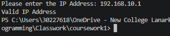
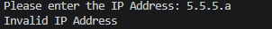
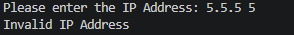

# IP Address Validator

Programming for Cyber Security: Coursework 1, Task 3

## Student Details

| | |
|---|---|
| **Name** | Mohammed Ahmed |
| **Campus** | New College - Motherwell |
| **Banner ID** | B01886625 |

## Program Specifications

This program asks the user to enter an IP address and cconfirms whether it is a valid IP address or not.

**An address is only valid if:**

- it contains only three dots.
- every part contains only digits.
- every number is between 0 and 255.

## Testing

### Valid Input

### Invalid Input

