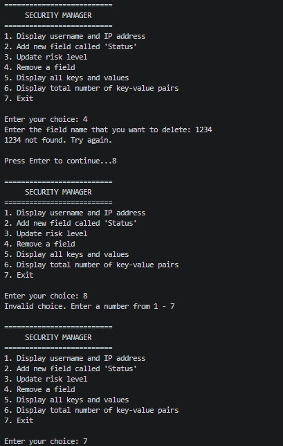

# Security Incident Manager

Programming for Cyber Security: Coursework 1, Task 4

## Student Details

| | |
|---|---|
| **Name** | Mohammed Ahmed |
| **Campus** | New College - Motherwell |
| **Banner ID** | B01886625 |

## Program Specifications

This program manages the details of a security incident, stored in a dictionary. The user works through a menu to view, add, update, and remove information about the incident.

**The incident starts with these fields:**

|FIELD|STARTING VALUE|
|---|---|
|`username`|admin|
|`ip`|192.168.10.1|
|`event_type`|Brute Force Login|
|`risk_level`|High|

### Menu Options

1. **Display username and IP address**: Shows the `username` and `ip` values.
2. **Add new field called 'Status'**: asks the user to enter a status.
3. **Update risk level**: asks for a new risk level and replaces the current one.
4. **Remove a field**: asks for a field name and deletes it.
5. **Display all keys and values**: lists every field and its value.
6. **Display total number of key-value pairs**: shows how many fields the incident currently has.
7. **Exit**: exits the program.

## Testing

### Valid Input

### Invalid Input

